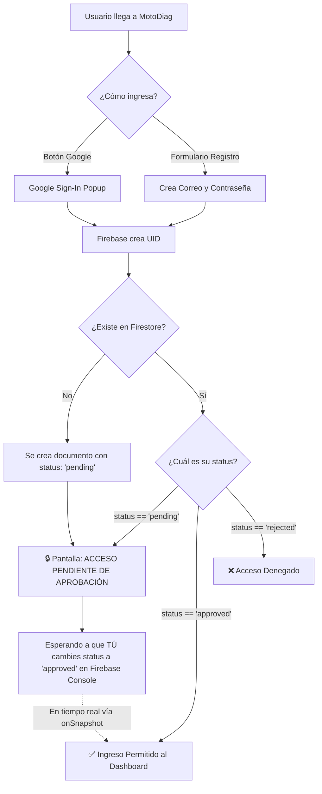

# 🔐 Guía Exhaustiva: Configuración de Firebase y Sistema de Aprobación de Usuarios

Esta guía detalla paso a paso cómo configurar **Firebase Authentication**, **Cloud Firestore** y **Realtime Database** para MotoDiag IA, y cómo funciona el **Sistema de Admisión Exclusiva** donde **solo tú (el Administrador)** puedes aprobar a quienes intenten iniciar sesión con Google o con usuario/contraseña.

---

## 🛡️ 1. ¿Cómo Funciona la Solución de Aprobación?

### El problema:
Por defecto en Firebase Auth, cualquier persona con una cuenta de Google o que cree un usuario/contraseña puede registrarse. Si no existiera un filtro, cualquiera podría entrar y ver la telemetría de tu moto.

### La solución implementada en MotoDiag IA:
Hemos programado un **filtro de admisión en dos fases** (Autenticación + Base de Datos Firestore):



1. **Intento de Acceso:**
   - Si una persona inicia sesión con su cuenta de Google o completa el formulario de registro, Firebase valida sus credenciales y le asigna un **UID** único.
2. **Estado por defecto ('pending'):**
   - El sistema automáticamente crea su registro en la colección `users` de Firestore con `status: "pending"`.
3. **Bloqueo Visual Inmediato:**
   - La aplicación bloquea el acceso al panel de telemetría y muestra la pantalla:
     > **"Acceso Pendiente de Aprobación"**
     > *Hola [Nombre]. Tu cuenta ha sido registrada pero requiere autorización directa del Administrador en Firebase para ver la telemetría.*
     > *UID: [código único]*
4. **Tu Aprobación en la Consola:**
   - Tú abres la consola de Firebase en tu navegador (o celular), buscas su correo, cambias el texto `"pending"` por `"approved"` y guardas.
5. **Desbloqueo en Vivo:**
   - ¡No necesitan refrescar! La app tiene un **listener en tiempo real (`onSnapshot`)** que detecta tu cambio instantáneamente y desbloquea el dashboard de la moto en la pantalla del usuario.

---

## 🚀 2. Configuración Paso a Paso en la Consola de Firebase

### Paso 2.1: Crear tu Proyecto en Firebase
1. Ve a [https://console.firebase.google.com](https://console.firebase.google.com) con tu cuenta de Google.
2. Haz clic en **"Crear un proyecto"** (o *"Add project"*).
3. Nombre sugerido: `motodiag-telemetria` (o el que prefieras).
4. Desactiva o activa Google Analytics (es opcional) y haz clic en **"Crear proyecto"**.

---

### Paso 2.2: Habilitar Autenticación (Google y Correo)
1. En el menú lateral izquierdo de Firebase, ve a **Compilación (Build)** > **Authentication**.
2. Haz clic en **"Comenzar"** (*Get started*).
3. En la pestaña **"Sign-in method"** (Métodos de acceso):
   - **Proveedor 1: Correo electrónico/contraseña (Email/Password)**
     - Haz clic en él, marca la casilla **"Habilitar"** y guarda.
   - **Proveedor 2: Google**
     - Haz clic en Google, marca la casilla **"Habilitar"**.
     - Selecciona tu correo electrónico en **"Correo electrónico de asistencia para el proyecto"**.
     - Haz clic en **"Guardar"**.

> **Nota para Vercel o dominio propio:**
> En la pestaña **Settings** (Ajustes) de Authentication > **Authorized domains** (Dominios autorizados), asegúrate de agregar el dominio de tu despliegue en Vercel (por ejemplo: `motodiag.vercel.app`) además de `localhost`.

---

### Paso 2.3: Crear la Base de Datos Firestore (Para la Aprobación de Usuarios)
1. En el menú lateral, ve a **Compilación** > **Firestore Database**.
2. Haz clic en **"Crear base de datos"**.
3. Selecciona la ubicación más cercana (por ejemplo `nam5 (us-central)`).
4. En reglas de seguridad, selecciona **"Comenzar en modo de prueba"** (*Start in test mode*) y haz clic en **Habilitar**.

---

### Paso 2.4: Crear la Realtime Database (Para el ESP32)
1. En el menú lateral, ve a **Compilación** > **Realtime Database**.
2. Haz clic en **"Crear base de datos"**.
3. Selecciona la ubicación (Estados Unidos `us-central1`).
4. Selecciona **"Comenzar en modo de prueba"** para permitir lectura/escritura inicial durante tus pruebas.
5. Copia la URL que aparece arriba, tendrá este formato:
   ```
   https://tu-proyecto-default-rtdb.firebaseio.com/
   ```
   *(Esta es la URL que colocas en `config.h` del ESP32 y en `app.js`)*.

---

### Paso 2.5: Obtener las Credenciales Web SDK
1. En la consola de Firebase, haz clic en el ícono de engranaje ⚙️ (junto a "Descripción general del proyecto") > **Configuración del proyecto**.
2. Desplázate hacia abajo hasta la sección **"Tus apps"** y haz clic en el ícono web **`</>`**.
3. Ponle de apodo: `MotoDiag Web`. No es necesario marcar Firebase Hosting. Haz clic en **"Registrar app"**.
4. Verás un bloque de código como este:
   ```javascript
   const firebaseConfig = {
     apiKey: "AIzaSy...",
     authDomain: "tu-proyecto.firebaseapp.com",
     databaseURL: "https://tu-proyecto-default-rtdb.firebaseio.com",
     projectId: "tu-proyecto",
     storageBucket: "tu-proyecto.appspot.com",
     messagingSenderId: "1234567890",
     appId: "1:1234567890:web:abcdef..."
   };
   ```
5. Abre `js/app.js` y reemplaza el objeto `defaultFirebaseConfig` con tus valores reales.

---

## 👨‍💻 3. Cómo Aprobar a un Usuario en 10 Segundos

Cuando una persona intente entrar con Google o se registre con correo:

1. Abre tu [Firebase Console](https://console.firebase.google.com).
2. Entra a tu proyecto y haz clic en **Firestore Database** en el menú izquierdo.
3. Haz clic en la colección llamada **`users`**.
4. Verás la lista de documentos con los UID de las personas que han intentado entrar.
5. Al hacer clic sobre el documento verás los campos:
   - `email`: `"amigo@gmail.com"`
   - `displayName`: `"Carlos Moto"`
   - `status`: `"pending"`
   - `creadoEn`: fecha y hora
6. **Para APROBAR:**
   - Haz doble clic sobre el valor `"pending"` del campo `status`.
   - Cámbialo por: `"approved"`
   - Presiona Enter o clic en **Guardar**.
   - ¡Listo! En el mismo instante, la pantalla del usuario se desbloqueará sola y podrá ver toda la telemetría de la Yamaha YCZ 110.
7. **Para RECHAZAR:**
   - Cambia el campo `status` por `"rejected"` o elimina el documento.

---

## 🔒 4. Reglas de Seguridad Recomendadas para Producción

Cuando vayas a dejar el sistema en producción permanente, puedes aplicar estas reglas en la pestaña **Reglas (Rules)** de Firestore:

```javascript
rules_version = '2';
service cloud.firestore {
  match /databases/{database}/documents {
    match /users/{userId} {
      // El usuario puede leer su propio documento para verificar si fue aprobado
      allow read: if request.auth != null && request.auth.uid == userId;
      
      // El usuario puede crear su documento inicial solo si status es 'pending'
      allow create: if request.auth != null && request.auth.uid == userId
                    && request.resource.data.status == 'pending';
      
      // Solo el administrador puede modificar el campo status a 'approved'
      allow update: if request.auth != null && 
                    (request.auth.token.email == 'tu-correo-admin@gmail.com' || 
                     resource.data.rol == 'admin');
    }
  }
}
```

---

## 🏍️ 5. Conexión del ESP32 con Firebase

En el archivo [firmware/src/config.h](file:///C:/Users/WinterOS/Desktop/Motodiag/firmware/src/config.h):
1. Confirma tu red WiFi:
   ```c
   #define WIFI_SSID       "iPhone Andres"
   #define WIFI_PASSWORD   "andresj123"
   ```
2. Pega tu URL de Realtime Database:
   ```c
   #define FIREBASE_HOST   "https://tu-proyecto-default-rtdb.firebaseio.com"
   ```
3. Compila y sube el firmware a tu ESP32 con Arduino IDE o PlatformIO.
4. Cuando el ESP32 encienda y se conecte a los datos de tu iPhone, enviará cada 1 segundo la temperatura del DS18B20 y la vibración del MPU6050 directamente a la ruta `/dispositivo/live.json`.
